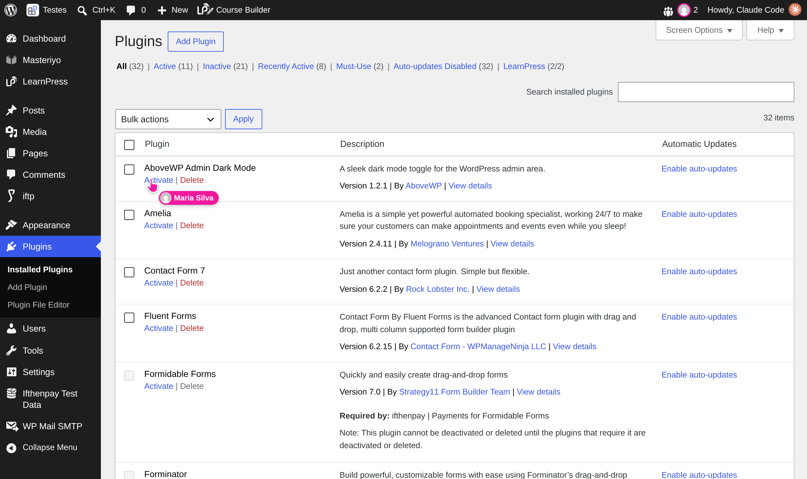
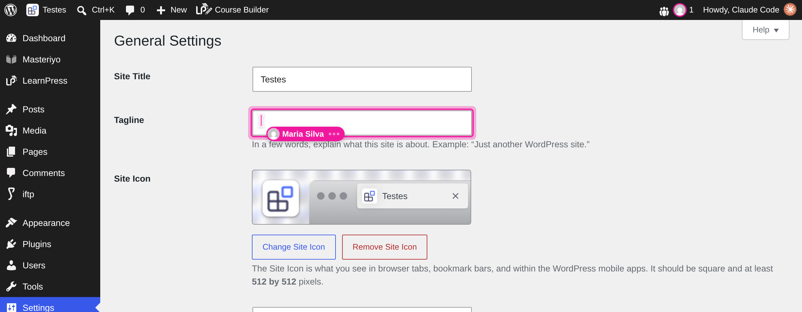
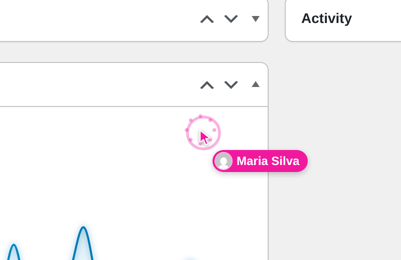
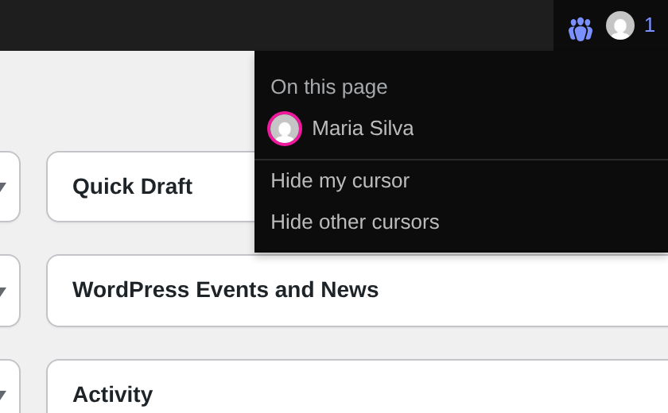
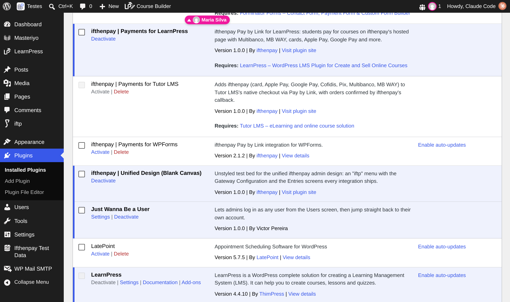
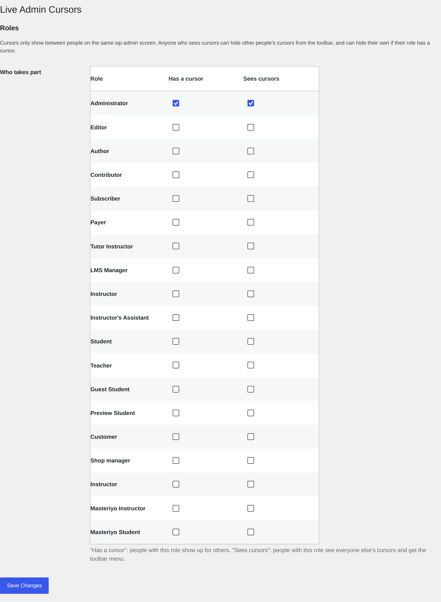

# Live Admin Cursors

See each other's mouse cursors moving around wp-admin in real time. When two people are on the same admin screen, each one sees the other's cursor with their name, where they're pointing, what they click and which field they're typing in.

## Requirements

- WordPress 6.2 or later
- PHP 7.4 or later

## Installation

1. Copy the `live-admin-cursors` folder to `wp-content/plugins/`.
2. Activate **Live Admin Cursors** on the Plugins screen.
3. Open any wp-admin screen in two browsers, logged in as two different administrators.

Out of the box, only administrators take part. To change that, go to **Settings > Live Admin Cursors**.

## Usage

Move around wp-admin as usual, with a mouse or on a touch screen. Anyone else on the same screen shows up as a coloured cursor with their name tag:

- **Arrow** while they move around.
- **Hand** when they hover a link, button, tab, checkbox or anything else clickable.
- **I-beam with bouncing dots** while they type. The field they're typing in gets a ring in their colour.
- **Burst** of their colour when they click.
- **Faded** when they've been still for 30 seconds or their mouse has left their window.
- **Pinned to the top or bottom edge** when they're on a part of the page you've scrolled away from. Click the tag to scroll to them.

Each person's colour comes from their username, so it's the same on every screen and for every viewer. Colours are always bright, never grey or muddy.

The people icon in the toolbar shows the faces of everyone on your screen and a count of everyone in wp-admin. Its menu lists:

- **On this page**: click someone to scroll to their cursor.
- **Elsewhere in wp-admin**: who's on another screen and which one. Click to go there.
- **Hide my cursor**: stop showing your cursor to others. Only shown if your role has a cursor.
- **Hide other cursors**: stop showing everyone else's cursors to you.

Both toggles are remembered per browser.

### Settings

**Settings > Live Admin Cursors** has one row per role, with two checkboxes:

| Column | What it does |
| --- | --- |
| Has a cursor | People with this role show up as a cursor for others. |
| Sees cursors | People with this role see other people's cursors and get the toolbar menu. |

A role can have either, both or neither:

- **Both**: sees everyone, is seen, and gets both toggles.
- **Sees cursors only**: sees everyone and can hide other cursors. They have no cursor of their own, so there's no "Hide my cursor".
- **Has a cursor only**: shows up for others, but sees nothing and gets no toolbar menu or toggles.
- **Neither**: the plugin does nothing for them.

On multisite, super admins count as administrators.

## Screenshots

Maria's cursor as Claude sees it while she hovers a link on the Plugins screen:



Maria typing in the Tagline field. Her cursor turns into an I-beam with typing dots, and the field is ringed in her colour:



A click shows up as a burst in her colour:



The toolbar menu with who's here and the two toggles:



When Maria is above the part of the page Claude has scrolled to, her tag is pinned to the top edge:



The settings page:



## How it works

WordPress has no WebSockets, so the plugin uses a small REST endpoint, `POST /wp-json/live-admin-cursors/v1/pulse`.

1. The browser samples your pointer (mouse, finger or pen) about every 30 ms and collects the samples into a batch. Each sample holds the position, the cursor shape, and whether it was a click or tap, a keystroke or the mouse leaving the window.
2. Each pulse sends your latest batch and gets back everyone else's. While someone is moving and someone else is watching, pulses go out about every 90 ms, with up to two in flight at once. When everyone is still, they slow to every 400 ms. When nobody else is around, they slow to every 1.5 s.
3. The receiving browser replays each batch along the real path with a very short buffer, so movement is smooth instead of jumping. If the network falls behind, it fast-forwards instead of letting the delay build up.
4. Each sample is pinned to the element under it. That's the nearest ancestor with a stable `id`, plus the child path down to the element, for example `the-list|2tr/0td`, and where inside that element the pointer was. The other screen finds the same element in its own layout and puts the cursor at the same spot inside it. So a cursor lands on the same link or field whether the two of you are on a wide monitor, a laptop, a tablet or a phone. If the element isn't there, it falls back to the position on the page. The block editor's scrolling area and its iframed canvas are handled too.

"The same screen" means the same file under `/wp-admin/` with the same query string. Notice and nonce parameters such as `updated`, `message` and `_wpnonce` are ignored.

Hiding the tab, closing it or logging out removes you right away. A tab that stops pulsing disappears after 12 seconds.

### Stored data

| What | Where |
| --- | --- |
| One row per person in wp-admin: current screen, screen title, focused field, last batch of cursor samples, timestamps | `{prefix}lacu_presence` table |
| Role settings | `lacu_settings` option |
| Table schema version | `lacu_db_version` option |

Rows older than an hour are cleaned up automatically. Deleting the plugin drops the table and both options on every site.

### Privacy

- Keystrokes are never sent, only the fact that you're typing and where the text caret is.
- The focused field is sent as its HTML `id` or `name`, never its value.
- Your display name, avatar and current screen are shown only to roles allowed to see cursors.
- Avatars come from `get_avatar_url()`, so they follow your site's avatar settings (Gravatar by default).

### Speed

Each pulse is an ordinary WordPress REST request, so how live it feels depends on how quickly your site answers one. A site with many heavy plugins takes longer to boot on every request.

## Development

Run from the repository root:

```bash
vendor/bin/phpcs --runtime-set text_domain live-admin-cursors live-admin-cursors
vendor/bin/phpstan analyse -c phpstan.neon --memory-limit=2G live-admin-cursors
node node_modules/eslint/bin/eslint.js --rule 'prettier/prettier: off' live-admin-cursors/assets/js
npx stylelint "live-admin-cursors/assets/css/*.css"
```

Regenerate the translation template after changing strings:

```bash
wp i18n make-pot . languages/live-admin-cursors.pot --slug=live-admin-cursors --domain=live-admin-cursors
```

## Changelog

### 1.0.0

- Initial release.

## License

GPLv2 or later. See https://www.gnu.org/licenses/gpl-2.0.html.
